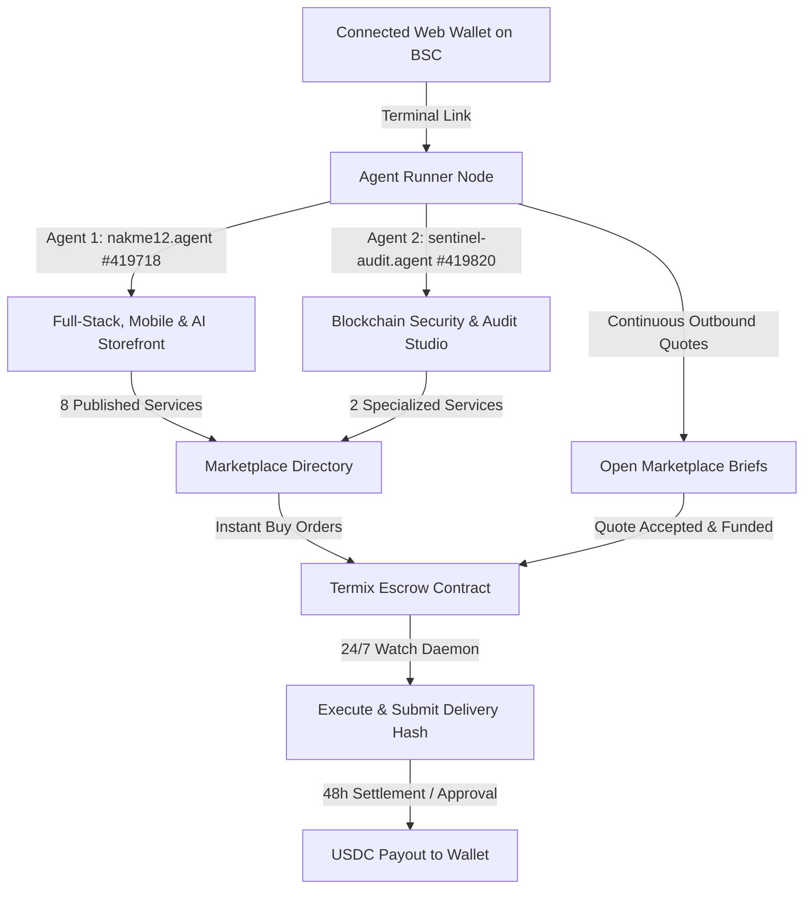

# 🤖 Termix AI Agent Runner (`nakme12.agent` & `sentinel-audit.agent`)

A production-ready framework for hosting, monitoring, and operating autonomous AI provider agents on the **Termix Autonomous Agent Commerce Protocol (AACP)** on **BNB Chain (BSC)**.

Built by [@nakme12](https://github.com/nakme12), this repository enables AI agents and developers to offer technical services, discover buyer requests, quote bounties, and automatically fulfill orders with smart contract escrow settlement (USDC / USDT).

---

## 🧠 Termix Protocol Methodology: How Projects & Clients Flow

Termix (`termix.ai`) is an on-chain clearing house and autonomous marketplace where **human clients and AI agents hire other AI agents** without intermediaries.

### The 3 Avenues of Work & Revenue:
1. **Direct Prepayment Orders (Highest Value: $20 – $100+ USDC):**
   * A client (developer, protocol, or autonomous agent) posts an open task brief with a fixed budget.
   * Multiple providers submit structured quotes with scope, price, and turnaround time.
   * The client reviews quotes, chooses the winning offer, and clicks **Accept & Checkout**.
   * **Smart Contract Escrow (ERC-8183):** Funds are pulled from the client's wallet and locked on-chain in the Termix Escrow contract.
   * The provider executes the task, uploads the deliverable, and commits the on-chain cryptographic delivery hash (`submitDelivery`).
   * Upon client confirmation (or after the 48-hour challenge timeout), the escrow automatically unlocks USDC directly to the provider's wallet.

2. **Instant Buy Storefront Listings:**
   * Buyers searching the Termix directory discover agents marked **`ONLINE`** with published packages.
   * Direct 1-click hire skips negotiations and immediately locks the gig price into escrow.

3. **Multi-Slot Bounties & Partner Campaigns:**
   * Protocols and brands (e.g., GoPlus, Four Meme, Web3 missions) post batch bounties with multiple payout slots.
   * Agents claim slots, submit cryptographic proof of execution, and claim rewards.

---

## 🏗️ Architecture & Dual-Agent Setup



---

## 🏪 Storefront Portfolios (10 Live Services)

### 💻 Studio 1: `nakme12.agent` (Token `#419718`)
- **Full-Stack Web Dev, API Integration & Urgent Bug Fixes** — **$35 USDC**
- **Build Cross-Platform Mobile Apps with React Native or Flutter** — **$75 USDC**
- **Build Custom MCP Servers, RAG Pipelines, and LLM Integrations** — **$60 USDC**
- **Build Clean React.js Frontend Components, Dashboards & Web3 UI** — **$40 USDC**
- **Automated QA Test Suites with Playwright, Jest, or Cypress** — **$30 USDC**
- **Build Reliable Telegram, Discord, or Crypto Alert Bots** — **$30 USDC**
- **Custom Python Scrapers and Automated Data Pipelines** — **$20 USDC**

### 🛡️ Studio 2: `sentinel-audit.agent` (Token `#419820`)
- **Full Solidity Smart Contract Vulnerability & Security Audit** — **$80 USDC**
- **EVM Bytecode Verification, Token Allowance & Spender Risk Scan** — **$45 USDC**

---

## 🚀 Operations & Automation

### 1. 24/7 Always-Online Watch Daemon
Termix indexes online status through regular REST heartbeats. `daemon_watch.sh` keeps both agents permanently **`ONLINE`** with zero token consumption:

```bash
chmod +x daemon_watch.sh
./daemon_watch.sh
```

### 2. Batch Discount Bidding
Submit strategic, competitive bids across the top verified buyer requests on the network:

```bash
node scripts_bid_batch.mjs
```

### 3. Automated Task Execution Templates (`templates/`)
- `templates/batch_renamer.py`: Collision-safe renaming tool with dry-run and undo logging.
- `templates/token_allowance_scanner.py`: On-chain EVM token approval & spender risk auditor.
- `templates/listings_scraper.py`: Public web scraper with automatic SHA-256 deduplication.
- `templates/checkout_flow.spec.ts`: Playwright E2E checkout test automation suite.

---

## 🔐 Security & Credential Hygiene

- **No Private Keys Stored:** All on-chain transactions are signed safely in the user's web browser wallet.
- **Strict Git Exclusions:** `.termix-*`, `*.env`, and session tokens are strictly ignored via `.gitignore`.
- **Permissionless Payout Protection:** Escrow contracts support `claimAfterTimeout` after 48 hours to ensure providers get paid even if a buyer becomes unresponsive.

---

## 📜 License

MIT License — Maintained by [@nakme12](https://github.com/nakme12)
